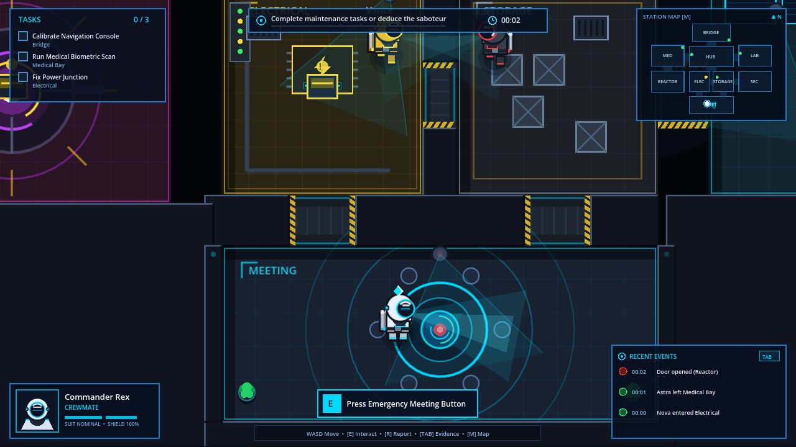
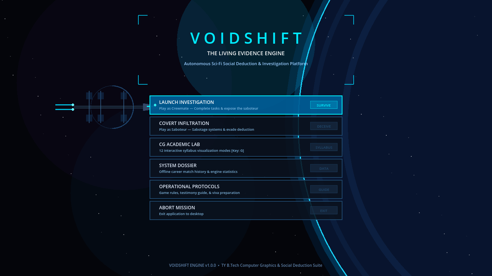

# VOIDSHIFT: The Living Evidence Engine

> **Autonomous Sci-Fi Social Deduction & Computer Graphics Investigation Platform**  
> *Developed with Godot 4.7 Engine and Pure C++20 / Windows GDI Architecture.*

---

## 🚀 Overview

**VOIDSHIFT: The Living Evidence Engine** is a stylized science-fiction social deduction game and academic computer graphics demonstration suite. Set aboard the orbital research vessel *DSS Chronos*, crew members must complete maintenance tasks and deduce the hidden saboteur through dynamic contradiction analysis powered by the **Living Evidence Engine**.

Unlike traditional static social deduction games, every character action, room transition, door state change, and CCTV camera sighting is recorded into a verifiable chronological timeline. During emergency meetings, crew testimonies are automatically cross-referenced against ground-truth evidence to detect spatial-temporal contradictions.

---

## 📸 Screenshots

### 🕹️ Live Gameplay
*Featuring responsive HUD hierarchy, 2.5D bulkhead architecture, vector-rendered crewmates with dynamic vision cones, and live Recent Events feed.*


### 🌌 Main Menu & Title Screen
*Featuring the DSS Chronos starship silhouette, gas giant atmospheric horizon, and responsive tactical operation cards.*


---

## 🎮 Key Features

- **The Living Evidence Engine**:
  - Real-time event logging: `ENTER_ROOM`, `COMPLETE_TASK`, `TRIGGER_SABOTAGE`, `DISCOVER_BODY`, `USE_VENT`, and `CCTV_SIGHTING`.
  - Automatic contradiction detection: compares crew statements against CCTV sweeps and door access timestamps.
  - Interactive Evidence Dossier accessible at any time via `[TAB]`.
- **2.5D Architectural Station Environment**:
  - Distinct sector styling: Clinical Medical Bay, Industrial Reactor Core with rotating magnetic confinement rings, Electrical power distribution, Security surveillance bank, and central Meeting holo-table.
  - Hazard thresholds, corner status LEDs, dynamic drop shadows, and environmental storytelling.
- **Vector-Rendered Astronauts**:
  - 7 unique role palettes (Commander Rex, Engineer Vance, Scientist Nova, Medic Astra, Security Kael, Comms Lyra, and Saboteur).
  - Anti-aliased vector rendering with curved reflective visors, life monitor ECG pulses, dual oxygen tanks, and atmospheric vision cones.
- **Contextual & Responsive HUD**:
  - Top objective pill with match timer and progress bar.
  - Non-overlapping tactical blueprint minimap with live crew radar blips.
  - Commander Rex biometric status card.
  - Context-aware floating interaction pill (`[E]` / `[R]`).
  - Live Recent Events feed streaming from the evidence engine.
- **Academic Computer Graphics Lab**:
  - Full interactive suite demonstrating core syllabus algorithms:
    - **2D Transformations**: 3x3 Homogeneous Matrix pipeline (Translation, Rotation, Scaling, Reflection, Shear).
    - **Line Algorithms**: DDA (Digital Differential Analyzer) & Bresenham's Integer Line.
    - **Circle Algorithms**: Midpoint Circle & Bresenham's 8-Way Symmetry.
    - **Clipping & Shading**: Cohen-Sutherland line clipping and polygon rendering.

---

## ⌨️ Controls & Keybindings

| Key | Action | Context |
| :--- | :--- | :--- |
| **`W, A, S, D`** / **`Arrows`** | Move Astronaut | World navigation |
| **`E`** | Contextual Interaction | Perform task / Emergency meeting button |
| **`R`** | Report Body | Near a fallen crewmate |
| **`TAB`** | Open / Close Evidence Dossier | Review live investigation timeline |
| **`M`** | Toggle Tactical Station Map | Full-screen navigation overview |
| **`G`** | Launch CG Academic Lab | Switch to interactive graphics syllabus |
| **`SPACE`** | Eliminate Crewmate | Saboteur Infiltration mode |
| **`V`** | Enter / Exit Ventilation Duct | Saboteur Infiltration mode |
| **`ESC`** | Back / Close Modal / Pause | System menus |

---

## 📁 Repository Structure

```
├── godot_game/                       # Godot 4.x Production Project
│   ├── project.godot                 # Godot project configuration
│   ├── scenes/
│   │   ├── main/Main.tscn            # Primary game orchestration scene
│   │   ├── player/Player.tscn        # Player controller & Camera2D
│   │   ├── ai/CrewmateBot.tscn       # AI autonomous agent scene
│   │   └── tests/ScreenshotScene.tscn# Automated headless QA runner
│   └── scripts/
│       ├── core/                     # GameManager, GameEnums, StationData
│       ├── render/                   # CrewmateRenderer, StationMapRenderer
│       ├── evidence/                 # LivingEvidenceEngine & Timeline
│       ├── tasks/                    # TaskManager & mini-games
│       ├── ui/                       # GameHUD, MainMenu, MeetingScreen, etc.
│       ├── academic/                 # GraphicsAlgorithms, AcademicMatrix2D
│       └── tests/                    # AutomatedVerification test suite
├── src/                              # Pure C++20 / Windows GDI Engine
│   ├── main.cpp                      # C++ entry point
│   ├── Game.cpp / Game.h             # Core C++ game loop
│   ├── GraphicsAlgorithms.cpp / .h   # Native DDA, Bresenham & Midpoint
│   ├── Matrix.cpp / Matrix.h         # 3x3 Transformation math
│   ├── AIPlayer.cpp / .h             # C++ AI state machines
│   ├── MeetingSystem.cpp / .h        # C++ Meeting & Evidence logic
│   └── Renderer.cpp / .h             # Windows GDI software renderer
├── docs/                             # Documentation and screenshots
│   └── screenshots/                  # High-resolution in-game captures
├── build.bat                         # C++ compilation script (MSVC / MinGW)
├── run_godot_game.bat                # Godot 4 game launcher script
└── .gitignore                        # Git configuration
```

---

## 🧪 Automated Verification & Testing

The project includes an autonomous test suite (`AutomatedVerification.gd`) verifying all mathematical, logic, and state systems:

```
=======================================================
   VOIDSHIFT: AUTOMATED VERIFICATION SUITE STARTING   
=======================================================

[PASS] Test 1: 3x3 Homogeneous Matrix Mathematics & Transformations
[PASS] Test 2: DDA & Bresenham Line Rasterization Algorithms
[PASS] Test 3: Midpoint & Bresenham Circle 8-Way Symmetry Algorithms
[PASS] Test 4: The Living Evidence Engine Timeline & Contradiction Detection
[PASS] Test 5: Station Blueprint, Vents, Tasks, and Camera Layout
[PASS] Test 6: Task Mini-Games Progression & Completion
[PASS] Test 7: Sabotage System Meltdown & Repair

=======================================================
   VERIFICATION RESULT: 7 / 7 TESTS PASSED   
=======================================================
```

To run the automated tests headless:
```powershell
godot --headless -s "res://scripts/tests/AutomatedVerification.gd"
```

---

## 🛠️ How to Build and Run

### Running the Godot 4 Game
1. Launch with **Godot Engine 4.x** (Standard 64-bit):
   ```powershell
   .\run_godot_game.bat
   ```
   Or via Godot CLI:
   ```powershell
   godot --path "godot_game"
   ```

### Building the Native C++ Engine
1. Run the MSVC / MinGW build script:
   ```powershell
   .\build.bat
   ```
2. Launch the resulting binary:
   ```powershell
   .\SpaceDeduction2D.exe
   ```

---

## 👥 Authors & Academic Attribution
- **Tejas Bankar** ([@Tejasbankar5](https://github.com/Tejasbankar5))
- Developed for Computer Graphics & Autonomous Social Deduction Systems.
